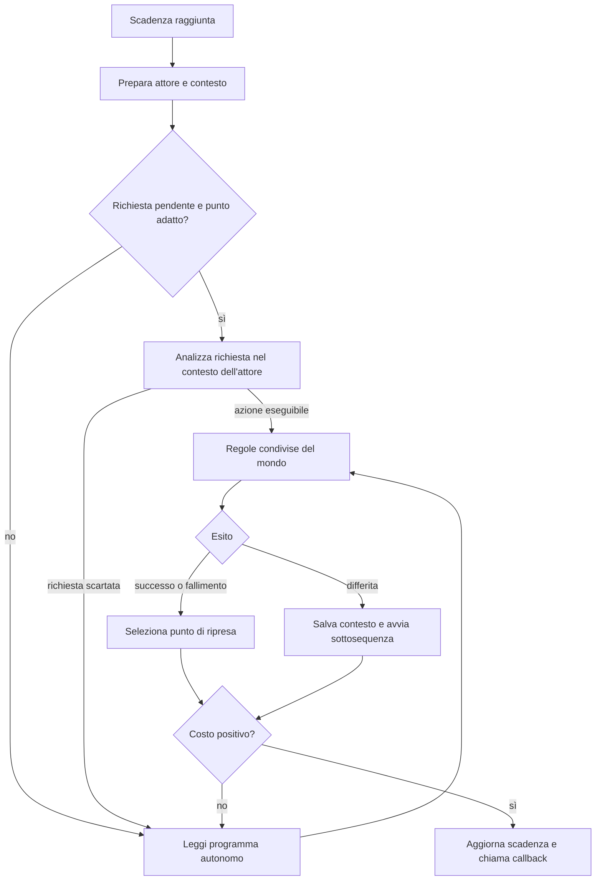

# Sherlock: prima ricostruzione dell’AI dei personaggi

Analisi del payload ZX Spectrum v2.0 `block-10.bin`, SHA-256 `c5d48285c0cee5c25cf4734dff0ac8296c0ec0194135e3a72267e49724ac8407`. Indirizzi esadecimali; ID e contatori decimali. Le conclusioni derivano dal codice originale e dalle prove Z80 riproducibili descritte qui. Il manuale e Foggy London sono stati consultati come contesto, non come dimostrazione del comportamento.

**Il comportamento dei personaggi combina programmi individuali, regole condivise, richieste ricevute, segnali fra attori e routine speciali.** Non c’è, nei percorsi esaminati, un pianificatore generale che inventi ogni volta un piano. Il programma stabilisce quali possibilità provare; lo stato del mondo e l’esito delle regole determinano quale ramo prendere, quanto aspettare e quali effetti produrre.

Sono state decodificate le sequenze di Watson, Lestrade e Basil, con le sottosequenze differite raggiunte. L’indice di tutti i 24 attori è in `results/scripts.json`. Non sono ancora spiegati tutti i corpi Z80 richiamati né tutte le conoscenze e conversazioni della vicenda.

## 1. Dal turno alla decisione

Il ciclo principale già studiato scandisce gli attori in ordine fisso. Una riga da otto byte conserva ID, punto di ripresa del programma, tre valori di lavoro e scadenza. Quando la scadenza è raggiunta:

1. `$CC37` prepara l’attore e controlla se esiste una richiesta a lui destinata.
2. `$CC78` ripristina il suo contesto e legge il bytecode successivo.
3. Se c’è una richiesta e il punto di ripresa è un’operazione ordinaria, `$B936` prova a elaborarla.
4. Se non viene eseguita una richiesta, l’interprete prosegue il programma autonomo.
5. Azioni e regole possono riuscire, fallire o aprire una sottosequenza differita.
6. Un costo positivo restituisce il controllo allo scheduler. Il punto di ripresa viene conservato per la visita successiva.
7. Dopo la visita lo scheduler richiama l’eventuale callback del personaggio.



Il diagramma riassume il caso ordinario; asserzioni e ritorni da contesti sospesi hanno raccordi specifici. L’input del giocatore segue lo stesso scheduler. I controlli sintattici falliti non costituiscono automaticamente un turno del mondo.

### Non necessariamente una decisione per minuto

Una visita può contenere molte condizioni e operazioni a costo zero. `$CC0B` conta i fallimenti: a dieci, `$CD8B` restituisce costo 1. Anche un ramo di fallimento che ritorna sullo stesso opcode cede con costo 1. Questa protezione evita che un’attesa di una condizione occupi indefinitamente la CPU. Non è un limite universale contro ogni ciclo: per esempio l’opcode `$0C` raggiunge intenzionalmente un `JR` su se stesso a `$CD08`.

## 2. Il linguaggio dei programmi NPC

Il nibble basso dell’opcode seleziona l’operazione. I byte successivi sono operandi o puntatori, non istruzioni Z80.

| Tipo | Dimensione base | Funzione |
|---|---:|---|
| 00 esatto | 1 | Byte azzerato: l’interprete lo salta. |
| 01 | 2 | Azione senza argomenti espliciti. |
| 02 | 4 | Azione con due argomenti. |
| 03 | 3 | Regola a puntatore, senza argomenti. |
| 04 | 5 | Accoda un ordine già codificato a un altro attore. |
| 05 | 4 | Battuta rivolta a un destinatario. |
| 06 | 3 | Stampa un testo compresso. |
| 07 | 5 | Regola a puntatore, con due argomenti. |
| 08 | 2 | Invia un segnale al destinatario. |
| 09 | 2 | Cerca e consuma un segnale del mittente indicato. |
| 0A / 0B | 1 | Ritorna dalla sottosequenza con fallimento / successo. |
| 0C | 5 secondo la routine di lunghezza | Trappola a `$CD08`; non trattarla come un normale comando eseguibile. |
| 0D | 2 | Costo 1; il secondo byte non è letto dal gestore osservato. |
| 0E | 3 | Salto assoluto. |
| 0F | 1 | Cede con costo 1. |

Per le operazioni ordinarie, i bit alti aggiungono controllo del flusso:

- `$80`: word di destinazione in caso di successo, subito dopo gli operandi.
- `$10`: word di destinazione in caso di fallimento; segue quella di successo, se presente.
- `$20`: dopo il successo cancella i byte dell’operazione. È un meccanismo di esecuzione una tantum, verificato su una fixture; non è presente nelle tre sequenze NPC estratte.
- `$40`: flag consultato da alcune regole per rifiutare istruzioni ricevute dal giocatore durante questa fase. Non significa «ignora qualsiasi comando».

Salti e ritorni hanno gestori propri: non si devono estendere indiscriminatamente tutte le combinazioni di flag a ogni tipo. Il decoder descrive i byte e i rami statici; non esegue i corpi Z80.

### Operandi dinamici

`$CEDE` traduce alcuni valori:

| Byte | Valore letto |
|---|---|
| FA | Slot `$9FD6`: spesso l’ultima azione, ma riusato anche per una locazione, un genitore o altri risultati. |
| FB | Attore corrente `$A036`. |
| FC | Secondo argomento salvato `$9FD8`. |
| FD | Primo argomento salvato `$9FD7`. |
| F5–F9 | Alias del primo argomento, secondo il codice; non attribuiamo loro ulteriori significati. |
| FE / FF | Restano invariati; il significato dipende dalla regola/classe dell’argomento. |

È importante non tradurre sempre FA come «verbo precedente»: Watson vi salva la locazione di Holmes prima di tentare di raggiungerlo.

## 3. Ordini di Holmes: ricezione, esecuzione, rifiuto

`SAY TO` usa la regola `$DD9E`. Il destinatario deve essere percepibile e deve figurare nella tabella degli attori per far analizzare il contenuto della citazione. Il parser della citazione produce una richiesta nella lista con testa `$9FEE`.

La richiesta contiene otto byte utili, preceduti dal collegamento della lista:

| Offset | Citazione analizzata |
|---|---|
| +0 | ID del destinatario. |
| +1 | Tipo 0. |
| +2 | Stato di elaborazione dei gruppi/argomenti, aggiornato dalla semantica. |
| +3/+4 | Cursore di lavoro della risoluzione. |
| +5/+6 | Lista dei nodi sintattici ancora da elaborare. |
| +7 | Modo del parser; 2 distingue le asserzioni. |

`$B91F` cerca una richiesta per l’attore. `$B936` ne riprende la risoluzione semantica e poi usa `$C4D1`, lo stesso esecutore delle azioni del giocatore. Il programma autonomo resta sospeso al proprio punto, non viene sostituito definitivamente dal comando ricevuto. `$9FE9` raccoglie i contesti necessari alle azioni differite; `$CFCF` li ripristina e libera.

Questo spiega tre risultati distinti:

- `SAY TO WATSON "TAKE LAMP"`: Watson esegue TAKE, la lampada passa al genitore 3 e viene stampato `Watson takes the oil lamp.`
- `SAY TO WATSON "TAKE ARMCHAIR"`: nella prova la richiesta non produce TAKE né un errore sintattico nella zona utente. Un comando sintatticamente valido può fallire nella semantica o nelle condizioni del mondo.
- `SAY TO LESTRADE "WAIT"`: nel punto iniziale del suo programma risponde `Sorry, I cannot do that now.` e continua a chiamare un cab.

### Il rifiuto è verificabile, non una personalità ipotizzata

Il bytecode di Lestrade a `$E7E9` vale `$43`: chiamata a regola con bit `$40` attivo. `$B953` copia quel byte a `$B934` durante la risoluzione di una citazione. Alcuni predicati chiamano `$CBA7`; se il bit è attivo, producono il rifiuto.

La prova causale `lestrade_wait_flag_clear` è identica a `lestrade_wait`, salvo l’azzeramento di quel solo bit: `$43 → $03`. Il risultato diventa `Inspector Lestrade waits.`. È una fixture esplicita, non una modifica del gioco consegnato.

La verifica è limitata a questa fase e a queste azioni. TAKE non passa necessariamente dallo stesso filtro; restano comunque i vincoli ordinari di capacità, possesso, percezione, ecc. Non abbiamo trovato qui una misura generale di «fiducia» che spieghi tutti i rifiuti. Le affermazioni del manuale sulla prolissità e sul giudizio degli interlocutori non vengono assunte come meccanismi già dimostrati.

## 4. I personaggi possono impartire ordini ad altri personaggi

L’opcode 04 crea nella stessa lista `$9FEE` una richiesta già risolta:

```text
+0 destinatario
+1 FF               tipo: ordine prefabbricato
+2 azione
+3 argomento1
+4 argomento2
```

Questo percorso salta lessico e parser e recupera direttamente i tre valori a `$B98C`. Nella traccia naturale Lestrade sale nel cab e, al tick 5, ordina al cocchiere di andare a Kings Cross Road. Il cocchiere, ID 31, riceve il dispatch nel medesimo tick perché viene dopo Lestrade nell’ordine degli attori.

**La coda è condivisa, ma gli ingressi non sono identici.** L’ordine prefabbricato non imposta `$B934` come fa la citazione. Una fixture invia WAIT a Basil mediante opcode 04 mentre il suo programma ha il bit `$40`: WAIT viene eseguito con costo 5. Rimangono applicabili gli altri controlli delle regole. Non bisogna quindi ricostruire tutti gli ordini NPC come stringhe passate attraverso `SAY TO`.

Un opcode 05 che stampa una battuta e un opcode 04 che accoda un’azione non sono equivalenti, anche se entrambi possono apparire sullo schermo come dialogo.

## 5. Segnali di sincronizzazione

Gli opcode 08 e 09 gestiscono una lista distinta, con testa `$9FE7`. Ogni elemento è una coppia:

```text
mittente, destinatario
```

Il mittente viene ricavato dall’attore corrente. Il ricevente cerca un elemento indirizzato a sé, con il mittente richiesto; quando lo trova lo rimuove. Non è una frase interpretata né un segnale con un contenuto testuale.

Esempi statici:

- Lestrade emette segnali a Straker e attende risposte in vari punti della sequenza.
- Basil inizia a `$EE2B` con `59 04 2B EE`: cerca un segnale da Straker (ID 4), e se manca riprova lo stesso punto al turno seguente.

La fixture automatica dimostra l’intero ciclo: Basil senza segnale cede con costo 1; Straker invia `[4,6]`; Basil lo consuma e avanza con costo zero. Il segnale non rimane disponibile per essere consumato due volte.

## 6. Watson: copione iniziale e seguito dinamico

La sequenza principale occupa `$E72F–$E799` e `$E7B6–$E7E1`; `$E79A` è l’intestazione di una regola differita, non la prosecuzione lineare del programma.

### Lettura e presentazione del caso

1. Stampa il saluto iniziale, testo `$6DEB`.
2. Crea un contatore privato: `13 + casuale(0..4)` mediante `$E52F`.
3. Aspetta nella sottosequenza `$E79C`. A ogni ciclo controlla di essere ancora nella stanza 8 e di possedere/percepire il Daily Chronicle (entità 25).
4. Quando il contatore termina, controlla se Holmes è nella stessa locazione. Se sì, stampa il lungo racconto dei delitti (`$6E02`). Se Holmes è assente, ha un ramo che può annunciare il caso al suo rientro (`$6EFC`).
5. Introduce un secondo contatore, `15 + casuale(0..10)`.
6. Terminata questa fase, se Holmes è presente aspetta; se è assente lascia la nota 26 nella stanza 8 e sposta Watson nella locazione 0, poi entra in un ciclo di attesa.

Le durate sono contatori del programma, non necessariamente minuti dall’input: ordini ricevuti e azioni positive possono rimandarne il decremento. Le prove partono dal primo prompt salvato, con il primo contatore già inizializzato a 15. Cambiare il seme dopo quel prompt non rigenera quel primo valore.

Nel confronto con seme 1/7 il secondo periodo termina rispettivamente ai tick 37 e 34. Il calcolo casuale è quello nativo `$D2A4`; non è stata dimostrata una distribuzione uniforme dei suoi valori.

### Come passa al seguito di Holmes

Se fallisce uno dei controlli della lettura, il programma arriva a `$E7B6`, elimina il contatore e passa a `$E7B9`. Da lì:

- legge la posizione corrente di Holmes;
- tenta di raggiungerla attraverso un’uscita diretta (`$DD52/$DD61`);
- se necessario prova a uscire dal contenitore in cui si trova, per esempio la poltrona;
- confronta le radici della catena di contenimento;
- può cercare di entrare nel contenitore del giocatore, come un veicolo;
- ripete i controlli quando torna il suo turno.

È un comportamento parametrico sullo stato del mondo. Non abbiamo dimostrato un algoritmo generale di ricerca del percorso: la routine `$DD61` qui segue un’uscita direttamente collegata alla destinazione.

Due prove dal prompt originale, senza alterare il mondo:

```text
SAY TO WATSON "DROP THE DAILY CHRONICLE"
OPEN YOUR DOOR
WEST
```

Watson lascia il giornale nella propria poltrona (genitore 24), interrompe la lettura, esce dalla poltrona e raggiunge Holmes nella locazione 7. Senza il primo comando, uscire dalla stanza e aspettare porta invece al ramo del biglietto: nella prova Watson risulta fuori mappa e la nota è nella stanza 8 entro il prompt al tick 39.

Anche `SAY TO WATSON "FOLLOW ME"` seguito da apertura della porta e WEST produce l’inseguimento. In quel caso entra nel comportamento differito dell’azione FOLLOW (`$E452`), distinto dal ramo autonomo `$E7B9`. La sequenza completa di FOLLOW non è inclusa nel decoder statico di questa fase; la sua esecuzione è nella traccia.

## 7. Lestrade e Basil: itinerari e scene condizionate

**Lestrade** ha una lunga sequenza a partire da `$E7E7`. Contiene spostamenti espliciti, esami di oggetti, battute, ordini, segnali e attese. La parte iniziale usa sottosequenze per chiamare un cab, identificarlo, salirvi e farsi portare alla stazione; nella prova raggiunge i binari senza che Holmes esca dalla propria stanza. Questo è progresso autonomo del mondo.

La vicenda successiva non è soltanto una lista di frasi da stampare a ore prefissate: ci sono test di presenza, attese di messaggi e regole che possono produrre eventi terminali. È stata decodificata la struttura, ma non abbiamo ancora verificato ogni scena di Lestrade in una partita completa.

**Basil** parte bloccato in attesa del segnale di Straker. Dopo il segnale, il suo programma contiene test dell’ora, trasferimenti anche verso la locazione 0, manipolazioni di oggetti, percorsi prescritti e controlli sulla presenza di Holmes o del travestimento cinese. Ad esempio `$EE7D–$EE8F` verifica le entità 0/1 nelle locazioni 32/102; il risultato seleziona se chiamare la scena `$EF9C`.

Il test temporale comune `$F1D6` confronta ora e am/pm, ma **non minuto né giorno**. Un operando 23 significa l’ora 11pm; la condizione può restare vera durante tutta quell’ora. La semantica deriva dal codice; le scene serali complete non sono ancora state percorse nelle prove.

## 8. Callback e reazioni a incontri

Dopo la visita di un attore, `$9C77` consulta una tabella di callback. È un altro livello di comportamento, separato dal puntatore del bytecode.

- Watson ha la callback `$9D13`: controlla incontri con Holmes, Lestrade e Straker tramite `$9CE9`; contiene contatori per evitare saluti continuamente ripetuti, e richiama `$E691`, che può selezionare informazioni da una lista.
- Lestrade parte dalla callback `$9DFF`: controlla compresenza/percezione di Straker e Holmes, cambia alcuni stati e sostituisce il proprio puntatore di callback con `$9D95`.
- Basil usa `$9CA2`, già studiata per la nota in fiamme: il contatore avanza alla callback del personaggio, non per una generica animazione dello schermo.

Le prove con Lestrade collocato nella stanza di Holmes fanno comparire saluti fra Lestrade e Watson senza ordini impartiti da Holmes. Queste reazioni derivano dal mondo e dalle callback, non dalla frase digitata dal giocatore. Le fixture di ricollocamento sono indicate esplicitamente nei JSON.

## 9. Informazioni e affermazioni: il terzo percorso

Bisogna distinguere:

1. **Ordine:** `TAKE LAMP` → risoluzione semantica e azione.
2. **Interrogazione:** `TELL ME ABOUT LESTRADE` → azione TELL ABOUT, ID 48.
3. **Affermazione:** `BASIL KILLED MRS BROWN` → modo 2 della citazione, gestore specifico.

A `$BA20`, il modo 2 seleziona `$BA67` per Watson e `$BB67` per Lestrade. In questo dispatch non ci sono gestori analoghi per gli altri ID. Il comportamento completo delle affermazioni rivolte agli altri NPC resta da verificare.

Nella prova al primo prompt:

- `SAY TO WATSON "WATSON IS INNOCENT"` produce una risposta di approvazione.
- `SAY TO WATSON "BASIL KILLED MRS BROWN"` produce un’altra risposta e aggiunge alla lista con testa `$9FF4` un record di cinque byte: `06 05 5E 00 00`.
- I due estremi 6 e 94 corrispondono a Basil e Mrs Brown; il valore centrale 5 è la relazione interna associata a questa affermazione nel caso osservato. Non è l’ID lessicale dell’azione KILL.
- `SAY TO WATSON "TELL ME ABOUT LESTRADE"`, nello stato iniziale, restituisce `I am sorry I cannot help you with that.`.
- Una frase riconosciuta come asserzione non è necessariamente utilizzabile: `THE LAMP IS IN THE ROOM` arriva al gestore, ma nella prova produce `What` e non aggiunge un record.

Questa è evidenza di una memoria di informazioni modificabile, oltre ai copioni. Non basta però per chiamarla una memoria privata completa di ogni NPC o un sistema generale di deduzione. La testa `$9FF4` è comune e il formato dei metadati, i predicati di valutazione, i fatti iniziali e il successivo uso delle informazioni devono ancora essere ricostruiti in dettaglio. L’approvazione stampata non è da sola una prova che ogni frase venga verificata come vera nel mondo.

## 10. Che cosa è scriptato e che cosa è dinamico

| Aspetto | Parte prestabilita | Parte valutata durante la partita |
|---|---|---|
| Itinerario | Ordine delle tappe e operazioni nel bytecode. | Possibilità di eseguire azioni, veicoli disponibili, attese. |
| Dialogo | Testi compressi e punti in cui possono essere pronunciati. | Presenza, richieste, rami e talvolta selezione casuale. |
| Obbedienza | Flag della fase, predicati e regole disponibili. | Comando ricevuto, oggetti risolti e loro stato. |
| Seguito di Holmes | Procedura che prova uscite e contenitori. | Posizione e genitore correnti del giocatore. |
| Cooperazione NPC | Ordini e protocolli scritti nelle sequenze. | Momento di ricezione e consumo dei segnali. |
| Ritmo | Costi e contatori previsti dal programma. | Scadenze effettive, interruzioni e valori casuali. |
| Informazioni | Regole di analisi e risposte disponibili. | Affermazioni ricevute e record aggiunti alla memoria. |

La distinzione utile non è «script contro AI»: gli script sono una parte dell’AI. Il risultato emerge dalla loro esecuzione sul mondo condiviso, con interruzioni, costi e comunicazione fra attori.

## 11. Prove e limiti

Gli script generano un catalogo di 351 operazioni nelle tre sequenze principali e 14 sottosequenze differite. Il listato distingue codice, intestazioni, bytecode e dati mutabili; ricompone 4389 byte identici al payload. Questa identità verifica il listato, non dimostra da sola i significati assegnati ai byte.

`npc-traces.json` contiene 17 scenari e 67 comandi: attese con due semi, ordini a Watson, seguito, partenza con biglietto, interrogazioni, asserzioni e rifiuti di Lestrade. Il verificatore aggiunge confronti diretti con le routine native di lunghezza, riferimenti dinamici, segnali, ordini prefabbricati e cancellazione una tantum.

Le prove partono dal prompt originale salvato, non dal motore semplificato della pagina web. Tutti gli attori, inclusi treni e cocchieri, sono abilitati. Si simulano solo i tasti e le pause della stampa; il codice del mondo e dell’AI viene eseguito dal simulatore Z80. I limiti di esecuzione vengono segnalati come limiti dello strumento, non come rifiuti del gioco. I/O nastro e fine partita sono confini di arresto.

I semi sono impostati dopo il primo prompt, con cursore del generatore azzerato: consentono confronti riproducibili di questi esperimenti, non equivalgono a un avvio originale da nastro con quel seme. Le tracce registrano i caratteri del canale superiore intercettato, non un’immagine esatta dello schermo. Il campo `request` degli eventi azione indica `$B934 != 0`; nei rami di ripiego può restare impostato temporaneamente, quindi non va usato da solo per attribuire l’origine di ogni azione.

**Prossimo approfondimento consigliato:** completare la memoria delle informazioni e i gestori di TELL/asserzioni, collegandoli alle callback e alle domande degli NPC. In parallelo, si potranno ricostruire gli itinerari degli altri personaggi. L’abilitazione dei turni NPC nell’esploratore web richiederà poi di gestire anche dialoghi, scene terminali e sospensioni; questa fase di analisi non cambia il comportamento della pagina in esecuzione.

Comandi e file: [GUIDA-SCRIPT.md](GUIDA-SCRIPT.md). Dettaglio delle sequenze: [results/SEQUENZE.md](results/SEQUENZE.md). Prove leggibili: [results/PROVE.md](results/PROVE.md).
