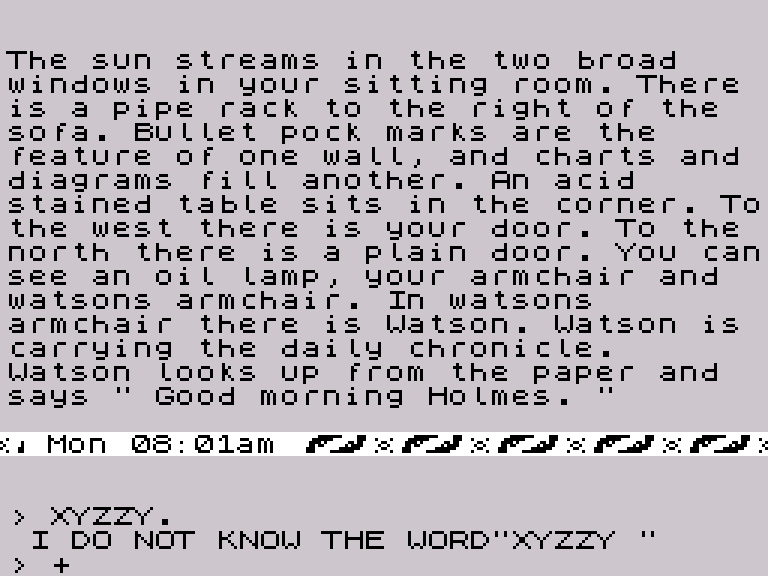
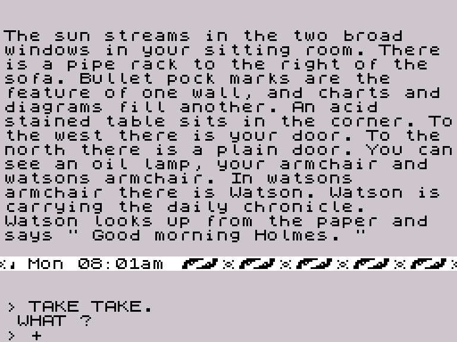

# Sherlock: dal comando digitato al controllo sintattico

> Questo rapporto conserva i risultati della prima fase. L’approfondimento di modi, citazioni e continuazioni è ora in `LEGGIMI-SPECIALI.md`; il laboratorio Python interattivo è descritto in `README-INTERATTIVO.md`.

Analisi del 19 ottobre 2026, sulla versione Spectrum già usata nel progetto. **Sono stati identificati ed eseguiti il percorso di input, il riconoscimento lessicale, la tokenizzazione e il parser sintattico.** Gli errori lessicali e sintattici osservati compaiono nell'area inferiore; i casi provati tornano al prompt senza avanzare l'orologio del gioco.

Il programma Python di accompagnamento esegue il codice Z80 originale per le prove complete. Contiene anche un modello Python indipendente della ricerca alfabetica nel dizionario, confrontato con l'originale su **1.804 input, senza divergenze**. Non è ancora la riscrittura Python del parser grammaticale o del gioco.

## 1. Materiale, attendibilità e riproduzione

Fonti primarie:

- `sherlock-analisi/block-10.bin`, payload a `$5D80–$FFFF`, SHA-256 `c5d48285c0cee5c25cf4734dff0ac8296c0ec0194135e3a72267e49724ac8407`;
- `sherlock-analisi/game-entry.z80`, verificato contro quel payload prima dell'avvio;
- SkoolKit 10.1 già presente nel progetto, usato come emulatore Z80, disassemblatore e assemblatore;
- decoder delle parole e delle frasi già sviluppato in `decoder/sherlock_text.py`.

Foggy London è stato usato come guida: pagina HTML, README, `FL.c`, `FL.h`, `Spectrum.c` e `Dictionary.txt`. **Le 592 voci del dump, comprese tutte le destinazioni dei rimandi, coincidono con i nostri record**: controllo registrato in `results/foggy-comparison.json`. I nomi delle classi del dump sono utili etichette di lavoro, non una definizione completa della grammatica.

Due motivi concreti per non considerare il tool una specifica infallibile:

1. `FL.c`, funzione `Build_Dictionary`, descrive correttamente i bit dei record, ma usa un limite inclusivo e contiene assunzioni proprie sul passaggio tra iniziali. Il dump testuale e l'esecuzione del lexer sono stati verificati separatamente.
2. `FL.c` modifica `$A88B` da `RET Z` a `NOP` per stampare parole anche con la stampa disabilitata; `Spectrum.c` osserva la stampa a `$A9B7`. Queste modifiche **non sono applicate nelle nostre prove**.

Anche `CARRY-[BS]IESD` nel dump richiede attenzione: il suffisso di indice 3 è precisamente `08 49 45 53`, cioè backspace + `IES`. La `D` successiva appartiene al suffisso di indice 4. La variante di stampa corretta è `carries`.

Dalla cartella del progetto:

```sh
python3 -B sherlock-analisi/parser/parser_audit.py build
python3 -B sherlock-analisi/parser/build_listing.py
python3 -B sherlock-analisi/parser/parser_audit.py lookup BOOKS
python3 -B sherlock-analisi/parser/parser_audit.py command 'GIVE BOOK TO WATSON'
```

`--project` e `--output`, se usati, vanno prima del sottocomando. `build` rigenera i risultati e le due schermate. `lookup` e `command` salvano anche `results/last-probe.json`. Il tool limita intenzionalmente le prove interattive a 70 caratteri ASCII; non pretende di verificare tutti i limiti dell'editor originale.

Il listing `parser.asm` contiene **1.780 istruzioni e 3.663 byte complessivi**, con ri-assemblaggio identico all'originale. Tabelle, variabili e record di script intercalati sono emessi come `DEFB`. Il controllo dei byte certifica la trascrizione, non sostituisce l'analisi del flusso.

## 2. Il percorso verificato

```text
D6C1 → D898: editor e Invio
       D949: normalizzazione finale della riga
D6CE → D9C5: controllo lessicale dell'intera riga
       ├─ token D0 → D6E5 → errore parola sconosciuta → prompt
       └─ token C0 → riga lessicalmente valida
D719 → D9C5: seconda scansione, costruzione del buffer di token
D780 → AAB2: analisi sintattica dell'unità corrente
       ├─ A=1 → D7BE → “What?” → prompt
       ├─ A=2 → trattamento speciale/vuoto, senza “What?” automatico
       └─ A=0 → lista di comandi a 9FF2
D7FC → B191: fase successiva, fuori dal perimetro delle prove
```

I blocchi non costituiscono un'unica funzione lineare: il controllo del gioco passa anche attraverso record interpretati. Per esempio `$D715` contiene `40 00 CE D6`, con riferimento a `$D6CE`; decodificare quei quattro byte come istruzioni CPU produce un falso disassemblato.

### Indirizzi da tenere a portata di mano

| Indirizzo | Funzione o dato |
|---|---|
| `$D898` | Editor, prompt e scelta del canale inferiore |
| `$A536` | Lettura del tasto con timeout |
| `$D949` | Trattamento di Invio |
| `$D6CE` | Preflight lessicale |
| `$D9C5` | Restituisce il prossimo token: classe in A/D, valore in BC |
| `$DA34` | Seleziona il gruppo alfabetico e prepara la parola digitata |
| `$DA7D` | Confronto dei prefissi e risoluzione dei rimandi |
| `$D719` | Serializza i token a `$5B81` |
| `$AE7F` | Legge i token per il parser |
| `$AAB2` | Parser sintattico |
| `$AB91` | Gruppo verbale |
| `$AC24` | Gruppo nominale |
| `$ACA6` | Copia il gruppo nominale nel nodo corrente |
| `$AFB3` | Dispatch dei token speciali di classe `$90` |
| `$D780` | Wrapper del parser e gestione del suo risultato |
| `$D7FC` | Passaggio alla fase successiva |

## 3. Che cosa fa l'editor prima del parser

Il buffer di testo comincia a `$5B00`; l'editor inizializza B a `$80`, cioè 128. Il buffer dei token comincia a `$5B81` e viene inizialmente azzerato per `$60` byte. Queste sono dimensioni e indirizzi osservati, non una prova che ogni caso di input al limite sia gestito correttamente.

A Invio, `$D949`:

1. se una citazione è rimasta aperta, la chiude;
2. inserisce un punto prima della virgoletta di chiusura, se manca;
3. aggiunge il punto finale della riga, se manca;
4. scrive il terminatore `$0D` e stampa il ritorno a capo.

Perciò `LOOK` diventa `LOOK.\r`. Sia `TELL WATSON "LOOK"` sia la versione senza virgoletta finale diventano `TELL WATSON "LOOK.".\r`. Non serve ipotizzare che il parser deduca da solo dove termina la citazione: l'editor prepara i delimitatori.

Sono presenti backspace, cancellazione della riga e scorciatoie direzionali al primo tasto: i codici `$09/$08/$0A/$5B` producono rispettivamente E/W/S/N e Invio. Il ramo `@` e lo stato di ripetizione richiedono un'analisi dedicata prima di essere riprodotti in Python.

L'attesa è temporizzata: `$A536` può restituire zero e attivare un percorso diverso da Invio. **Le prove qui iniettano subito i tasti e non misurano il comportamento dell'attesa senza input.**

## 4. Dizionario: struttura e contenuto

Indice di 32 word little-endian: `$5D80–$5DBF`. Base dei riferimenti: **`$5DBF`**. I 592 record effettivi occupano `$5DC0–$67B5`.

```text
byte 0: TTTT FFFF
        T = classe lessicale, F = variante/suffisso di stampa
byte 1: S PPP CCCC
        S = presenza del rimando di due byte
        PPP = lettere da conservare dalla voce precedente, esclusa l'iniziale
        CCCC = nuove lettere da decodificare
[lo hi] rimando opzionale: offset rispetto a 5DBF
[...]   nuove lettere, 5 bit per carattere
```

L'iniziale è implicita nel gruppo dell'indice. Il resto della parola è ricostruito incrementalmente in `$5C42`; il codice a 5 bit viene convertito aggiungendo `$60`.

Ci sono **29 record con rimando**. `$DAAD` segue il rimando fino a una voce senza rimando, restituendo la classe e l'offset della destinazione. Non è solo una traduzione del testo visualizzato: cambia il token consegnato al parser. Esempi verificati: `BREAK → KILL`, `CALL → HAIL`, `L/LO → LOOK`. Esiste anche l'insolito `IN → VISIT`, con passaggio alla classe `$E0`: è nei dati e viene seguito dal codice; non l'ho “corretto” in base all'inglese.

Le classi sono valori operativi del gioco, non parti del discorso inglesi rigorose:

| Classe | Voci | Comportamento osservato / esempi |
|---|---:|---|
| `$00` | 18 | Modificatore del gruppo verbale; CLOSELY, QUICK; anche alias L/LO |
| `$10` | 2 | IN/INTO; il parser tratta questa classe con le relazioni nominali, ma IN è un alias |
| `$20` | 19 | Direzioni: NORTH, SOUTH, E…; possono occupare il posto del verbo |
| `$30` | 41 | Gruppo verbale ordinario: TAKE, LOOK, GIVE; include anche MORNING/DAY tramite le rispettive forme memorizzate |
| `$40` | 3 | CLIMB, GO, RUN: trattamento speciale con la direzione |
| `$50` | 112 | Referente del gruppo nominale: BOOK, GUN, WATSON… |
| `$60` | 131 | Qualificatori nominali, compresi nomi propri usati come qualificatori: HEAVY, BASIL… |
| `$70` | 15 | Relazioni/preposizioni: TO, WITH, FROM… |
| `$80` | 11 | Elementi tipo articolo/ausiliare: THE, A, AT, ARE… |
| `$90` | 17 | Dispatch speciale: ALL, HE, IT, SAVE, QUIT…; non soltanto pronomi |
| `$A0` | 1 | AND; la virgola produce la stessa classe |
| `$B0` | 1 | THEN; il punto produce la stessa classe |
| `$D0` | 210 | Record esclusi dalla ricerca delle parole in input |
| `$E0` | 11 | Forme come IS, EXAMINED, KILLED; saltate nella ricerca ordinaria del gruppo verbale |

Non ci sono record lessicali di classe `$C0` o `$F0`: sono prodotti dal lexer rispettivamente per fine riga e literal numerici. `$D0` è anche il risultato “non riconosciuto”.

**592 record non significa 592 parole utilizzabili nei comandi.** Le 210 voci `$D0` servono al vocabolario dei testi, ma vengono saltate dalla ricerca. Inoltre abbreviazioni, alias e confronti per prefisso fanno sì che il riconoscimento di una stringa non coincida necessariamente con il record che la stampa. `dictionary.json` include per questo sia i dati del record sia `recognition_of_stem`.

## 5. Ricerca lessicale: non è una ricerca esatta

Il lexer `$D9C5` salta gli spazi, salva l'inizio della parola in `$A029`, tratta prima i token speciali, poi consulta il gruppo dell'iniziale. `$DA34` copia il resto dell'input in `$5C0B`, rendendolo minuscolo; per le normali parole continua mentre il carattere è almeno `$40`.

Per ogni candidato:

- `$A94D` ricostruisce la voce e aggiunge il suffisso;
- i record `$D0` vengono ignorati;
- `$DA7D` calcola la lunghezza del prefisso comune, contando anche l'iniziale;
- un candidato con prefisso uguale al migliore **sostituisce** quello precedente;
- la scansione si ferma quando il prefisso peggiora, oppure quando l'intero input era già stato riconosciuto;
- alla fine accetta se il prefisso comune è lungo almeno quattro caratteri, **oppure** copre tutto l'input.

Quindi anche abbreviazioni più corte di quattro lettere possono essere valide. La regola non è “confronta sempre e soltanto le prime quattro lettere”.

| Input | Risultato Z80 |
|---|---|
| `LOO` | LOOK |
| `LOOX` | Sconosciuto: soltanto tre caratteri in comune su quattro digitati |
| `LOOKXYZ` | LOOK: quattro caratteri bastano |
| `EXAM` | EXAMINE, classe `$30` |
| `EXAMXYZ` | EXAMINED, classe `$E0`, per il pareggio tra candidati |
| `BOOK` | BOOK, offset `$011B` |
| `BOOKS` | BOOKCASE, offset `$011F` |
| `ASK` | ASK |
| `ASKS` | Sconosciuto |
| `ABOVE` | Sconosciuto, benché esista una voce di stampa ABOVE |

### Perché i plurali possono sorprendere

Il suffisso appeso da `$A92F` contiene caratteri **maiuscoli**; l'input preparato da `$DA34` è minuscolo. Il confronto è byte per byte e non applica il backspace del suffisso. `bookS` e `books` quindi coincidono soltanto per i quattro caratteri `book`. `bookcase` ottiene lo stesso punteggio e sostituisce il candidato precedente: da qui `BOOKS → BOOKCASE`. Per `ASKS` restano tre caratteri comuni, insufficienti.

Il modello Python conserva questo comportamento; non introduce una normalizzazione dei plurali che il codice originale non esegue in questa fase. La generazione delle forme grammaticali **in uscita**, già studiata nel decoder dei testi, è un'altra operazione.

### Caso limite Z

Il limite finale indicato dall'indice è `$67B7`, mentre l'ultimo vero record termina a `$67B6` escluso. La scansione del gruppo Z può quindi interpretare anche il byte successivo come inizio di record e proseguire nei dati adiacenti. Nello stato iniziale provato, `Z` restituisce `$F0/$FFFF`; `ZZ` non termina entro 50.000 istruzioni. Questo è un risultato osservato con un limite di esecuzione, **non una dimostrazione di ciclo infinito**.

Il modello Python dichiara Z non supportata; i risultati Z80 sono conservati in `literals-and-boundary.json`. Non viene nascosta questa differenza dietro la dicitura “compatibilità completa”.

## 6. Token intermedi e literal

Il preflight `$D6CE` controlla la riga completa, incluso il testo tra virgolette, e si ferma alla prima parola sconosciuta. Solo dopo `$D719` ripete la scansione per costruire i token.

Formato a `$5B81`:

- classi minori di `$80`, più `$90/$E0/$F0`: tre byte `classe, B, C`;
- altre classi: un byte;
- `$C0`: fine della riga.

Il valore di due byte è **big-endian nel token stream**, a differenza dei puntatori Z80 e dei campi dei nodi, little-endian.

Esempio `GIVE BOOK TO WATSON.\r`:

```text
30 03 89   GIVE
50 01 1B   BOOK
70 08 DB   TO
50 09 71   WATSON
B0         punto
C0         fine riga
```

`THE` e `AT` diventano soltanto `$80`: la loro identità non è conservata nel token stream. AND e virgola diventano `$A0`; THEN e punto diventano `$B0`. La virgoletta è `$90 00 00`, distinta dai vocaboli di classe `$90` con offset nonzero.

Il lexer contiene già un riconoscitore di orari e denaro (`$DAEF–$DC12`), non un generico lettore di interi:

| Input | Classe / valore BC osservati |
|---|---|
| `1` | `$F0 / $8100` |
| `12:30` | `$F0 / $8C1E` |
| `12PM` | `$F0 / $8C40` |
| `60` | `$D0 / $0000`, non valido nel percorso orario |
| `2S` | `$F0 / $8098`, due scellini |
| carattere `$60` seguito da `1` | `$F0 / $81F0`, una sterlina; `$60` è £ nel set Spectrum |

Il ramo valuta calcola `(sterline × 20 + scellini) × 12 + pence` e impacchetta il valore in BC. Queste prove usano il codice originale. Il porting Python dei literal, incluse le particolarità dei registri a otto bit, è ancora da fare.

## 7. Il parser grammaticale

Il wrapper `$D780` imposta `$A024=1`, copia il cursore dei token da `$D6BD` a `$A02B` e chiama `$AAB2`. Il registro E viene usato come insieme di flag del parser; D conserva il tipo del token/delimitatore corrente. `$AE7F` fa avanzare il cursore e restituisce classe e valore.

### Gruppo verbale, `$AB91`

- `$30`: verbo ordinario, non duplicabile nello stesso gruppo;
- `$00`: modificatore del verbo;
- `$20`: direzione, usabile anche da sola come verbo;
- `$40`: GO/CLIMB/RUN, con riordinamento dei campi quando segue una direzione;
- `$E0`: saltata in questa ricerca.

`GO NORTH` viene normalizzato con NORTH nel campo principale e GO nel campo secondario. `TAKE TAKE` fallisce qui; `GO NORTH NORTH` fallisce per la combinazione ripetuta. `IS LOOK` supera questa fase, perché IS è `$E0`.

### Gruppo nominale, `$AC24`

Lo scratch di dieci byte a `$AAA8` contiene:

| Offset nello scratch | Significato operativo |
|---|---|
| `+0`, `+2` | Fino a due riferimenti di relazione/preposizione, classi `$10/$70` |
| `+4` | Referente centrale, classe `$50` o literal `$F0` |
| `+6`, `+8` | Fino a due qualificatori di classe `$60` |

L'articolo `$80` consuma uno stato disponibile; due articoli consecutivi nello stesso gruppo fanno fallire l'analisi. I qualificatori precedono il referente. Sono presenti ulteriori vincoli d'ordine e un contatore delle relazioni: non basta descrivere il tutto come “qualsiasi sequenza di nome e aggettivi”.

`$ACA6` copia il gruppo nel primo o nel secondo spazio del nodo. Un terzo gruppo fa fallire la sintassi. **Non viene ancora verificato se un oggetto esista nella stanza, sia prendibile o sia posseduto dal personaggio.** `TAKE 12:30` supera infatti questa fase.

### Nodo di comando

`$AE6A` richiede all'allocatore `$A11C` un nodo di 30 byte. Il collegamento al nodo successivo sta a `nodo-2`. Dopo il successo la testa della lista è a `$9FF2`; la lista temporanea era a `$9FF0`.

| Offset nel nodo | Campo |
|---|---|
| `+00` | Verbo/riferimento principale; alcuni bit alti sono flag |
| `+02` | Modificatore verbale/direzione o verbo di movimento riordinato |
| `+04…+0D` | Primo gruppo nominale, dieci byte |
| `+0E…+17` | Secondo gruppo nominale, dieci byte |
| `+18…+1D` | Sei byte di contesto per il modo speciale/pronomi |

Per `GIVE BOOK TO WATSON` sono stati verificati: `$0389` a `+00`, BOOK `$011B` a `+08`, TO `$08DB` a `+0E`, WATSON `$0971` a `+12`.

`TAKE BOOK AND GUN` produce due nodi: il verbo TAKE viene propagato. `TAKE BOOK GUN`, invece, produce un nodo con due gruppi nominali. L'accettazione di entrambe le forme è sintattica: non prova che producano la stessa azione nel gioco.

### Separazioni, citazioni e parole di controllo

La coordinazione salva uno stato di ritorno a `$ACCC`; può ereditare campi o lasciare il resto della riga a una successiva iterazione. `LOOK. THE` arriva al confine semantico con la prima unità LOOK: **non significa che la seconda unità THE sia già stata approvata**. Analogamente non va assunto che ogni riga composta sia eseguita in modo atomico.

La classe `$90` usa due tabelle di coppie `(offset parola, indirizzo handler)`, a `$AF6B` e `$AF9B`. I record sono dati, non assembler. La prima tabella comprende la virgoletta, ALL, BUT, PRINT, NOPRINT, LOAD, SAVE, PAUSE, HE, IT, QUIT e THEY. La seconda è usata nel modo 2 e comprende THAT, HE, IT, THEY, BECAUSE e THEREFORE.

La virgoletta apre un percorso specifico a `$B049`: registra il puntatore al contenuto, può fornire TALK (di cui SAY è un alias) come verbo implicito e sostituisce il token della virgoletta finale con `$C0`, per un'elaborazione differita. Il **lessico della citazione è già controllato**: `TELL WATSON "XYZZY"` fallisce nel preflight.

LOAD/QUIT, SAVE e PAUSE hanno effetti di controllo già da questi handler. Non tutto ciò che sta fisicamente dentro il parser è una funzione pura di controllo grammaticale. Le prove riconoscono questi handler e si fermano prima dei loro effetti; l'analisi dei dialoghi e del modo 2 resta da completare.

## 8. Errori e area dello schermo

### Errore lessicale

`$D6CE` riceve `$D0` dal lexer e restituisce l'indirizzo `$D6E5` come handler. Quest'ultimo:

1. imposta `$A027=1`, selezionando l'area inferiore;
2. stampa il testo compresso a `$6859`, `I do not know the word "`;
3. riprende dall'inizio della parola digitata, salvato in `$A029`;
4. stampa i caratteri fino allo spazio, trattando il punto come spazio;
5. chiude la virgoletta, va a capo e ripristina `$A027=0`.

L'output mantiene alcune spaziature insolite dell'originale: nella schermata si vede `I DO NOT KNOW THE WORD"XYZZY "`. Il JSON conserva il flusso di caratteri, la PNG la disposizione reale. La stessa via viene usata per un literal malformato: `LOOK 60` segnala `60` come parola sconosciuta.



### Errore sintattico

`$AF67` restituisce A=1/NZ. `$D780` libera le liste provvisorie con `$D87D/$D88A`, imposta il canale inferiore e stampa il template `$6866`: **`WHAT ?`**. Non emerge un catalogo di messaggi diversi per ciascun errore grammaticale: i casi provati convergono su questo messaggio generico.

A=2 è un risultato distinto e non stampa automaticamente `WHAT ?`: per esempio Invio a riga vuota torna al prompt senza errore.



Il router `$C1E1` controlla `$5C3C` e `$A027`. Il canale inferiore entra a `$C1FD` e converte le lettere in maiuscolo tramite `$C240`; quello superiore entra a `$C2BA`. Non è la frase compressa a scegliere da sola dove apparire: lo decide il chiamante mediante lo stato del canale.

### Messaggi da non confondere con la sintassi iniziale

`I do not know the verb…`, template `$686A`, è stampato da `$B84C`. La connessione è esplicita: `$B191` chiama `$B39D` e, in caso di fallimento, restituisce `$B84C` come handler. Si trova quindi **oltre il confine di questa analisi**.

Anche `Which … ?` (`$6888`, chiamante `$B5F5`) e i template a `$687C/$6880` appartengono al codice successivo di risoluzione. La presenza di un `What?` dentro quei template non li rende lo stesso errore del wrapper `$D780`.

## 9. Prove e limiti della conclusione

Sono state eseguite **39 prove del percorso completo** dal prompt iniziale: 22 raggiungono il confine prima della semantica, 6 falliscono lessicalmente, 7 sintatticamente, una è la riga vuota, tre raggiungono handler di controllo. Esempi:

| Comando | Esito prima della semantica |
|---|---|
| `XYZZY`, `TAKE XYZZY` | Parola sconosciuta |
| `BOOK`, `THE`, `TAKE TAKE` | WHAT ? |
| `TAKE THE THE BOOK` | WHAT ? |
| `TAKE BOOK BOOK BOOK` | WHAT ? |
| `TAKE THE` | Accettato; nessun referente obbligatorio in questa fase |
| `TAKE HEAVY BOOK` | Accettato con qualificatore |
| `GIVE BOOK TO WATSON` | Accettato con due gruppi nominali |
| `TAKE 12:30` | Accettato come struttura, senza giudizio sull'azione |
| `TELL WATSON "XYZZY"` | Parola sconosciuta anche dentro la citazione |

Per tutti i 13 errori ordinari sono stati verificati sia il ritorno al prompt, sia `$9FDD` invariato, sia il bitmap dei primi 128 pixel verticali dello schermo invariato. Le PNG mostrano anche la separazione visiva tra testo narrativo ed errore.

L'avvio parte dal payload originale e procede fino al prompt, con due pressioni N iniettate all'ingresso della lettura tasti: scelta grafica a `$A051` e continuazione della pagina a `$C30F`. Nei comandi si sostituisce soltanto l'attesa di `$A536` con i codici dei tasti. Il codice di editor, parser, allocazione e stampa viene realmente eseguito. Il gioco mantiene le proprie eventuali modifiche di stato/codice; non vengono introdotte patch da Foggy London o dal nostro harness.

La certezza riguarda **questa versione, questo stato iniziale e i casi registrati**. Non sono ancora coperti: tutte le combinazioni del modo 2 e delle citazioni, continuazioni dopo domande di disambiguazione, `@`, input lunghissimi, overflow numerici, attesa senza tasti, azioni semantiche e regole di gioco. Le abbreviazioni alfabetiche A–Y sono verificate anche contro il modello Python sui 1.804 input registrati; i numeri e il caso Z restano prove native, non porting Python.

## 10. File prodotti e seguito naturale

- `parser.asm`: listing commentato con separazione codice/dati.
- `build_listing.py`, `listing-verification.json`: generazione e controllo dei byte.
- `dictionary_lookup.py`: modello Python indipendente della ricerca alfabetica.
- `parser_audit.py`: avvio, esecuzione originale, osservazione e verifiche riproducibili.
- `results/dictionary.json` e `.txt`: 592 record con classi, varianti e alias.
- `results/foggy-comparison.json`: confronto con il materiale fornito.
- `results/commands.json`: 39 comandi, testo normalizzato, token, nodi, canale e orologio.
- `results/lookup-checks.json`: 1.804 confronti Python/Z80.
- `results/literals-and-boundary.json`: punteggiatura, orari/valuta e anomalia Z.
- `results/prompt.z80`, `error-unknown.z80`, `error-syntax.z80` e relative PNG: stati e schermate.
- `results/verification.json`: riepilogo delle verifiche e del perimetro.

Il prossimo passo, restando ancora sulla sintassi, è completare modo 2, citazioni e ripresa dei comandi, poi tradurre `$AAB2` in Python usando i token e i nodi osservati come riferimento. L'ingresso `$B191` offre un confine già identificato per affrontare in seguito la semantica.
