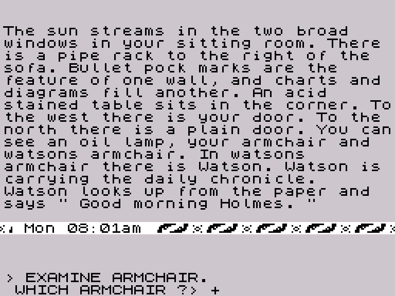

# Sherlock: modalità speciali, citazioni e continuazioni

Seconda analisi del parser, 19 ottobre 2026. Completa il percorso iniziato in `LEGGIMI-PARSER.md` e accompagna il programma interattivo `sherlock_parser.py`.

**Il parser distingue ordini e affermazioni. Le citazioni possono contenere entrambi, ma sono analizzate in un secondo passaggio. Le risposte di disambiguazione, invece, vengono fuse con un nodo di comando conservato appositamente.** Questi meccanismi sono ora osservabili dallo script interattivo, senza eseguire le azioni nel mondo del gioco.

Il programma è Python, ma per questa fase di studio usa il parser Z80 originale tramite SkoolKit. Non va confuso con una traduzione completa e indipendente del parser in Python. Il modello indipendente del solo confronto alfabetico, già disponibile, resta in `dictionary_lookup.py`.

## 1. Le tre modalità di `$A024`

| Valore | Impostato da | Comportamento |
|---|---|---|
| `0` | `$B8AA`, all'inizio di una citazione | Tenta di riconoscere un soggetto iniziale; sceglie modo 1 oppure 2 |
| `1` | `$D780`, input ordinario; oppure autodetect | Analisi di un comando, con verbo, modificatore e gruppi nominali |
| `2` | Autodetect oppure handler HE/IT/THEY | Analisi di un'affermazione con predicato e soggetto esplicito o pronominale |

Il codice è a `$AAD1–$AB10`. In modo 0 prova `$AC24` sul principio della frase. Se ottiene un gruppo nominale e il contatore delle relazioni `$AAA7` è zero, passa al modo 2, copiando sei byte da `$AAAC` al nodo `+18`: referente e due qualificatori del soggetto. Altrimenti ripristina il cursore e riparte in modo 1.

Il modo 2 non accetta qualsiasi verbo ordinario. `$ABF3` consulta una tabella di riferimenti a `$994D`, terminata da zero. Sono undici:

```text
BLACKMAIL HAD HAS IS KILLED VISIT HATED EXAMINED HID OWNS MADE
```

Sono riportate le forme dei record: i suffissi di stampa e gli alias possono farle apparire diversamente nel testo. La tabella completa, con indirizzi e offset, è in `special-tables.json`.

### Differenze osservabili

- `WATSON KILLED YOU`, digitato direttamente, produce errore: l'ingresso ordinario parte dal modo 1.
- `TELL WATSON "WATSON KILLED YOU"` viene accettato: il contenuto della citazione entra in modo 0, riconosce WATSON come soggetto e passa al modo 2.
- `HE KILLED YOU` viene accettato anche fuori dalle virgolette: HE attiva esplicitamente il modo 2.
- `TELL WATSON "LOOK"` produce una citazione di modo 1, cioè un comando.

L'etichetta “affermazione” descrive la struttura e il raccordo con l'elaborazione successiva, non certifica che quanto affermato sia vero o utile alla soluzione del gioco. Il record della citazione conserva il modo a `+07`; il percorso a `$BA20` collega il modo 2 all'elaborazione successiva, attraverso `$D1DB`. Questa seconda elaborazione non è eseguita dal programma interattivo.

## 2. Pronomi, THAT e connettivi

Gli handler sono in `$B0FD–$B16C` e sono selezionati dalle tabelle `$AF6B/$AF9B`.

### HE, IT e THEY

Il soggetto è memorizzato a `nodo+18…+1D`:

- HE imposta il bit `$80` del byte `nodo+19`;
- IT e THEY usano lo stesso handler e impostano il bit `$40` dello stesso byte;
- il referente effettivo non viene determinato qui.

Per esempio `HE KILLED YOU` produce un nodo con predicato KILLED, primo gruppo nominale YOU e flag HE sul soggetto. Lo script stampa **“HE (referente da risolvere)”**, evitando di inventare a chi si riferisca il pronome.

`HE HAD BOOK AND GUN` produce due nodi HAD; il soggetto pronominale viene propagato. Il formato non mantiene una distinzione tra IT e THEY nello specifico flag: la parola digitata resta visibile tra i token, mentre il nodo usa lo stesso valore.

### THAT

THAT è gestito nella tabella del modo 2. `$B0FD` copia sei byte da un gruppo nominale del nodo precedente al campo soggetto del nodo che viene costruito. Nel caso verificato:

```text
TELL WATSON "WATSON KILLED YOU, THAT HAD GUN"
```

si ottengono:

```text
soggetto WATSON — KILLED — referente YOU
soggetto YOU    — HAD    — referente GUN
```

Non è stato applicato un risolutore linguistico moderno: il risultato viene dalla copia di campi eseguita dallo Z80.

### BECAUSE e THEREFORE

In modo 2 entrambi conducono a `$AFFA`, che imposta D a `$A0` e passa alla coordinazione `$ACCC`. Nei nodi prodotti da questa fase non compare un flag distinto di causa/conseguenza.

`HE HAD BOOK THEREFORE IT IS GUN` produce due nodi, HAD e IS, con i rispettivi flag di soggetto. Lo script mostra il connettivo nei token ma non attribuisce ai nodi una relazione causale che questo formato non registra.

### Il modo non viene automaticamente azzerato a ogni punto

`$B8AA` mette `$A024=0` una sola volta, poi richiama `$AAB2` per le unità successive della citazione conservando lo stato raggiunto. Per questo:

- `"TAKE BOOK. DROP BOOK"` è valido;
- `"LOOK. WATSON KILLED YOU"` fallisce: WATSON non avvia un nuovo autodetect;
- `"WATSON KILLED YOU. LOOK"` fallisce nel percorso di modo 2.

Gli handler espliciti dei pronomi possono a loro volta cambiare modo. Lo script indica quindi il **modo finale** della scansione; non presume che una citazione composta venga riclassificata da zero a ogni frase.

## 3. ALL e BUT/EXCEPT

`$B033` gestisce ALL, cui rimanda anche EVERYTHING. Imposta `$A01A=1` e il bit `$80` del byte alto del verbo (`nodo+01`). Richiede un verbo o un contesto precedente appropriato.

`$B01C` gestisce BUT, cui rimanda EXCEPT. Richiede lo stato prodotto da ALL; alloca un nuovo nodo e ne marca il byte alto del verbo con `$40`. Questi nodi sono esclusioni collegate al comando, non azioni autonome.

```text
TAKE ALL BUT BOOK
    TAKE, flag ALL
    esclusione: BOOK
```

`TAKE EVERYTHING EXCEPT BOOK` produce la stessa struttura. `TAKE BOOK EXCEPT GUN`, ALL da solo e `TAKE ALL ALL` producono invece errore nei casi provati.

La lista contiene dunque più tipi di nodo: contarli indiscriminatamente come “numero di azioni” sarebbe sbagliato. Il programma identifica separatamente i nodi di esclusione.

## 4. Il ciclo delle citazioni

### Primo passaggio: il comando esterno

La virgoletta è il token `$90 00 00`. `$B049`:

1. se manca un verbo, inserisce `$088B`, **TALK**; SAY è un alias di TALK;
2. alloca un piccolo nodo con il puntatore ai token del contenuto e lo accoda alla lista con testa `$9FEC`;
3. salta fino alla virgoletta successiva con valore zero;
4. cambia temporaneamente quel token da `$90` a `$C0`.

Correzione di nomenclatura rispetto alla prima analisi: il riferimento implicito è il record TALK, non un record SAY autonomo. Il comportamento colloquiale può essere descritto come “dire”, ma nel listing e nello script è ora usato il nome canonico corretto.

Il controllo lessicale dell'intera riga è già avvenuto: una parola sconosciuta tra virgolette impedisce di arrivare a questo passaggio.

### Secondo passaggio: consumo della coda

`$B86A` legge la lista `$9FEC`. Il parametro A distingue due comportamenti:

- A nonzero: analizza il contenuto con `$B8AA`;
- A zero: scarta la citazione, ripristinando il delimitatore.

Il raccordo del gioco a `$DDA0` calcola quale caso applicare in base al referente individuato dalla fase precedente. Perciò **il fatto che il testo sia tra virgolette non garantisce che il gioco lo analizzerà o eseguirà in ogni situazione**.

`$B8AA` salva la lista esterna, imposta il modo 0 e analizza tutte le unità del contenuto. In caso di successo alloca un record di otto byte nella lista `$9FEE`:

| Offset | Dato |
|---|---|
| `+00` | Identità proveniente da `$A034`, stabilita fuori dal solo parser |
| `+01…+04` | Stato per l'elaborazione successiva, inizializzato dall'allocatore |
| `+05/+06` | Puntatore alla lista dei nodi sintattici del contenuto |
| `+07` | Modo finale 1 o 2 |

Il collegamento della lista sta, come negli altri nodi, a `record-2`. In caso di errore `$B904` libera la lista nuova e ripristina quella esterna.

### Errori interni e controllo anticipato dello script

`TELL WATSON "THE"` ha un involucro valido: il parser esterno costruisce TELL/WATSON. La successiva analisi della citazione restituisce errore.

Lo script verifica subito anche il contenuto, usando `$B8AA` su una copia della macchina, e riferisce **“errore sintattico nel contenuto di una citazione”**. Non afferma che il gioco stampi immediatamente `WHAT ?` al prompt per quel caso: la routine della citazione restituisce un esito, mentre la presentazione nel gioco dipende dal chiamante.

La chiamata diretta usata dal tool è stata confrontata con il consumatore originale `$B86A` su tre citazioni: comando valido, contenuto errato e affermazione valida. Esiti e byte dei nodi coincidono.

Sono supportate più citazioni nella stessa riga. Non è stata aggiunta una sintassi moderna per annidarle o usare escape: si applica la normale coppia di delimitatori del gioco, con la chiusura automatica già eseguita dall'editor.

## 5. Continuazioni dopo una domanda

### Come nasce lo stato pendente

Il codice di risoluzione sceglie quale gruppo nominale richieda una specificazione. `$B447` prepara gli offset `$08/$12`; `$B5B6`:

1. salva l'offset in `$A01B`;
2. sposta il primo nodo della lista `$9FF2` nella lista pendente `$9FF0`;
3. conserva il resto della lista e scollega il nodo pendente.

Gli offset sono **esadecimali**: `$08` indica il referente e qualificatori del primo gruppo; `$12` quelli del secondo. Non sono gli inizi dei gruppi completi (`+04/+0E`), che includono anche le preposizioni.

### Come la risposta viene fusa

Con `$A01B` nonzero, `$AAB2` ammette una risposta priva di verbo. `$AD6C–$ADD3` riunisce i risultati:

- se la risposta contiene un nuovo verbo, sostituisce il comando pendente;
- altrimenti conserva il verbo e riempie i campi vuoti del referente/qualificatori interessati;
- `$AE59` non sovrascrive una word già valorizzata;
- se il primo qualificatore è già occupato, il nuovo qualificatore può essere collocato nel secondo slot.

Esempi verificati in contesti espliciti:

| Base | Risposta / gruppo | Nodo risultante |
|---|---|---|
| EXAMINE ARMCHAIR | WATSONS / 1 | EXAMINE + ARMCHAIR qualificato WATSONS |
| GIVE BOOK TO WATSON | HEAVY / 2 | Il secondo gruppo conserva WATSON e aggiunge HEAVY |
| TAKE HEAVY BOOK | CLOSED / 1 | BOOK mantiene HEAVY e aggiunge CLOSED |
| TAKE BOOK | GUN / 1 | BOOK rimane: il campo era già valorizzato |
| TAKE BOOK | LOOK / 1 | Nuovo comando LOOK, senza BOOK ereditato |

La presenza di un nuovo nome non equivale quindi a una sostituzione testuale del nome precedente. La continuazione è una fusione di campi del nodo.

### Conferma nel flusso reale

Oltre alle chiamate isolate, una prova lascia avanzare la macchina originale fino alla domanda:

```text
> EXAMINE ARMCHAIR.
WHICH ARMCHAIR ?
> WATSONS.
```

È stato osservato `$B5B6` con A=`$08`, poi `$A01B=$08` al nuovo prompt. Il nodo ottenuto dopo WATSONS, fermandosi a `$D7FC` prima dell'esecuzione della risposta, coincide byte per byte con quello costruito dal test interattivo della continuazione.



Questo confronto attraversa il mondo soltanto per ottenere una domanda reale. Non traduce le regole che decidono l'ambiguità. Per esempio `TAKE ARMCHAIR` nel medesimo stato iniziale non dà la stessa domanda: il gioco risponde che non vede una poltrona prendibile. È un motivo concreto per non simulare automaticamente domande di disambiguazione basandosi soltanto sul testo.

### Come usare questo meccanismo nel laboratorio

```text
Sherlock> EXAMINE ARMCHAIR
Sherlock> /continua 1 WATSONS
```

`/continua` prepara esplicitamente la domanda con `$B5B6`, poi esegue editor e parser originali sulla risposta. Lo script non sostiene che il mondo del gioco avrebbe effettivamente posto quella domanda per ogni comando base.

Il contesto conservato è quello della prima testa della **ultima unità valida con nodi**, nell'ultima analisi completamente riuscita. Un errore successivo nella stessa riga non sostituisce il contesto già disponibile. Una nuova `/continua` è una nuova richiesta esplicita del laboratorio, non la simulazione dell'intero ciclo di dialogo dopo eventuali errori.

## 6. Ripetizione, comandi di controllo e righe multiple

### `@`

A inizio input, `$D99E` permette la ripetizione se `$A01B=0`. Il buffer precedente resta disponibile; il percorso passa nuovamente attraverso il controllo lessicale e la tokenizzazione. Durante una continuazione `@` viene ignorato dall'editor: la successiva pressione Invio può costituire una risposta vuota. Lo script lo segnala e non la presenta come una ripetizione riuscita.

### SAVE, LOAD/QUIT, PAUSE, PRINT, NOPRINT

Questi handler fanno parte del codice raggiunto durante il parsing:

- SAVE imposta lo stato di controllo relativo al salvataggio;
- LOAD e QUIT condividono `$B0AC`;
- PAUSE richiede un tasto;
- PRINT interroga la porta della stampante prima di abilitarla;
- NOPRINT cambia lo stato di stampa ed esegue un'operazione sul testo video.

Il tool lascia operare i cambiamenti nella propria macchina temporanea, sostituisce l'attesa del tasto, presenta una stampante assente e non entra nelle routine nastro o nel motore delle azioni. Non legge/scrive nastri e non invia dati a dispositivi esterni.

Le guardie d'ordine restano originali: `SAVE LOOK` è accettato, `LOOK SAVE` è errore. Nel secondo caso lo script non registra un salvataggio effettuato: il controllo sintattico dell'handler fallisce prima dei suoi effetti.

### Tutta la riga, non soltanto la prima unità

Il tool analizza le unità successive senza eseguirle. Per questo distingue:

- `LOOK. THE`: prima unità valida, seconda errata;
- `LOOK, THE`: il parser eredita LOOK e produce due nodi, nel caso provato;
- `TAKE BOOK AND DROP GUN`: due unità con verbi differenti;
- `TAKE BOOK AND GUN`: due nodi coordinati con TAKE ereditato.

La semantica potrebbe impedire al gioco reale di raggiungere una successiva unità; qui la verifica della riga completa è intenzionalmente anticipata e dichiarata. Le strutture precedenti a un errore vengono mostrate come risultati parziali, non come azioni già eseguite.

## 7. File, prove e limiti

- `sherlock_parser.py`: laboratorio interattivo, API `SherlockParser.analyse()` e output JSON.
- `README-INTERATTIVO.md`: istruzioni d'uso.
- `Avvia parser.command`: avvio da Finder/macOS.
- `parser-special.asm`: **480 istruzioni, 1.148 byte**, compresi dati esplicitamente separati dal codice.
- `build_special_listing.py`, `listing-special-verification.json`: rigenerazione e confronto byte per byte.
- `special-tables.json`: modi, undici predicati e due tabelle di dispatch.
- `verify_special.py`: prove riproducibili.
- `results-special/`: 56 comandi, 7 continuazioni, confronto con i 39 casi precedenti, tre confronti col consumatore delle citazioni, prova reale della domanda e sessione di esempio.

Tutti i controlli registrati passano. Il risultato dipende dal payload e dallo snapshot iniziale già verificati; non sono state applicate patch al codice del gioco. Le chiamate isolate usano uno stack e un ritorno controllati; le prove del flusso reale servono anche a controllare che questa strumentazione non cambi gli esiti rilevanti.

Limiti espliciti del laboratorio:

- massimo 70 caratteri stampabili per riga; ASCII, con conversione di £ al codice Spectrum;
- controllo prima di una scrittura oltre i 96 byte del buffer dei token;
- limite di 1.500.000 istruzioni per chiamata per evitare attese indefinite;
- arresto quando la ricerca esce dai record reali del dizionario: il caso Z della prima analisi può altrimenti dipendere dai byte adiacenti e dallo stato della macchina;
- i limiti producono **“analisi non conclusa”**, non un falso messaggio di errore grammaticale;
- pronomi, oggetti, destinatari e verità delle affermazioni non sono risolti;
- non si presume di aver provato ogni combinazione possibile del linguaggio originale.

Questa fase fornisce un riferimento eseguibile per i modi speciali e la continuazione. La traduzione indipendente del parser in Python potrà essere confrontata con questi token, nodi, risultati e casi di prova; l'analisi della semantica resta separata.
